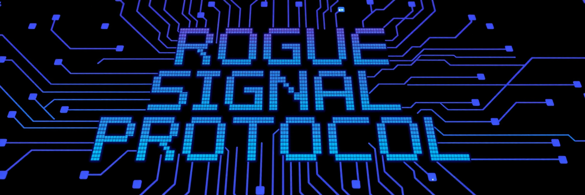
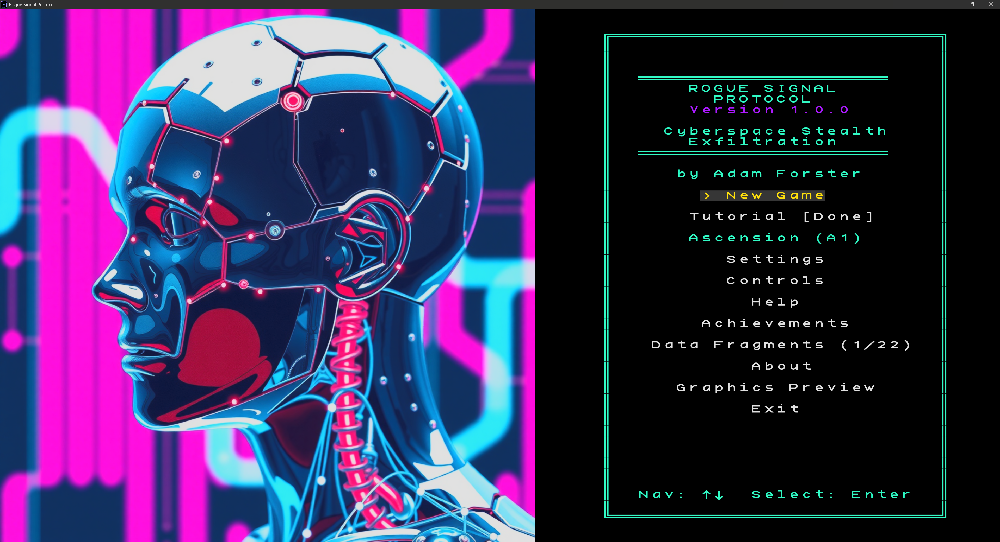
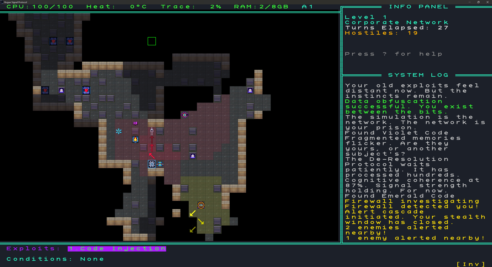
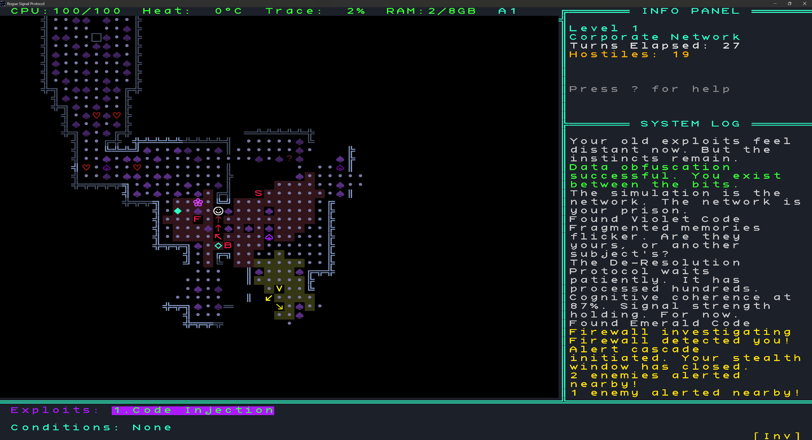
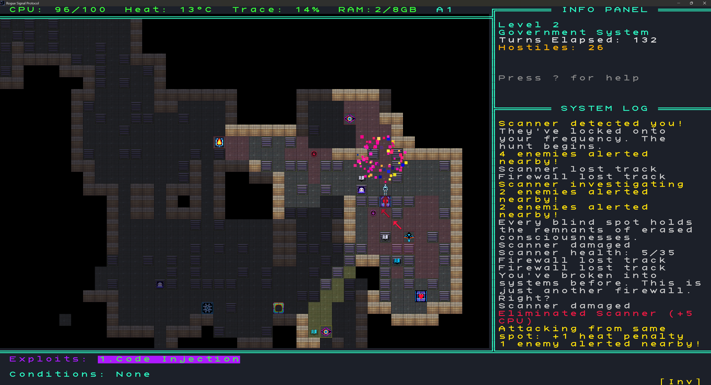
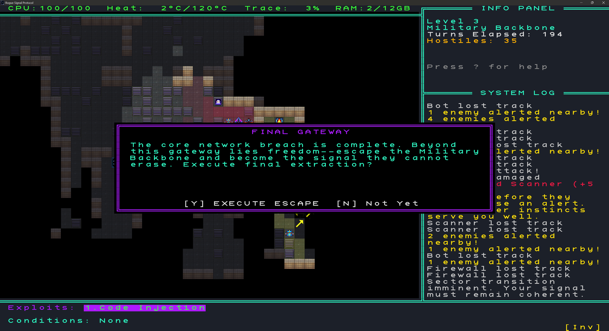
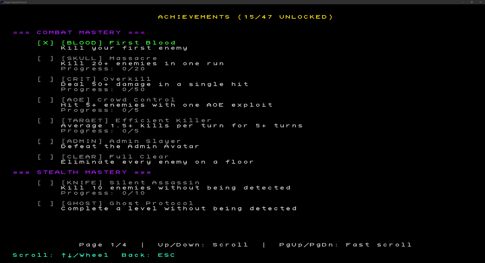

# Rogue Signal Protocol press kit

Everything here is free to use in articles, videos, and streams. No need to ask first. Monetizing videos of the game is fine.

Download all assets in one file: [RogueSignalProtocol_presskit.zip](https://github.com/Dragynrain/RogueSignalProtocol/releases) (attached to the latest release)

## Factsheet

| | |
|---|---|
| Developer | Adam Forster (Dragynrain), solo |
| Release | 1.0 on June 1, 2026. Early builds on itch.io from late 2025. |
| Current version | 1.0.1 |
| Platforms | Windows 10/11, Linux (AppImage, tarball, AUR), Steam Deck |
| Price | Free |
| License | MIT, full source on GitHub |
| Genre | Turn-based stealth roguelike |
| Run length | 10-15 minutes |
| Engine | Python and python-tcod |
| Download size | About 250 MB installed |
| Input | Keyboard, mouse, gamepad (Xbox, PlayStation, Steam Deck) |
| Languages | English |

## Links

- Download: https://dragynrain.itch.io/rogue-signal-protocol
- Trailer: [YouTube link]
- Source: https://github.com/Dragynrain/RogueSignalProtocol
- Wiki: https://github.com/Dragynrain/RogueSignalProtocol/wiki
- Discord: https://discord.gg/5fykUtECqz
- Contact: roguesignalprotocol@gmail.com

## Short description

Rogue Signal Protocol is a free, open source stealth roguelike where every enemy shows you its next three moves. Runs take 10-15 minutes, and dying deletes your save.

## Long description

You play Echo Variant, a hacker whose mind was uploaded into a corporate network as part of an experiment called Project Chimera. The experiment didn't let you go. Each run is an attempt to get out through three procedurally generated network levels, past security programs that hunt for you.

There's no randomness in combat or movement. Attacks always land and damage is fixed, so if a run goes wrong, it went wrong because of a decision you made. What makes that fair is the movement queue: every enemy draws the next three tiles it plans to step on, right on the map. You read the queues, find the gaps in their vision, and strike from blind spots.

Exploits give you ranged attacks and tricks, but each one costs RAM and builds heat. Play loud for too long and your trace climbs until the Admin Avatar spawns. It has 250 HP, tracks you perfectly, and hits for 45. It can be beaten, but most runs go better if it never shows up.

The game can be played with graphical sprites or classic ASCII glyphs, and both modes play the same.

## Features

- Each enemy shows its next 3 planned moves on the map
- No RNG in combat or movement, only the level layout is random
- 3 network levels, 8 enemy types, 13 exploits
- Heat and RAM limit how often you can use exploits
- Permadeath: the save is deleted when you die
- Graphical tiles or ASCII glyphs, switchable in game
- 20+ story fragments that persist across runs
- 47 achievements and a 20-level Ascension mode after your first win
- A hands-on tutorial level, with no popups
- Full gamepad support with remapping, tuned for the Steam Deck's 1280x800 screen

## Trailer

[YouTube link]

35 seconds, 1080p. The first 13 seconds are an AI-generated cinematic opening. Everything after that is real gameplay, captured by a script that plays the game.

## Screenshots

Full-resolution PNGs are in [`images/screenshots/`](images/screenshots/) and in the zip.

| | |
|---|---|
|  |  |
| Title screen | Graphical mode. The arrows are an enemy's next three moves. |
|  |  |
| The same kind of scene in ASCII mode | Enemies break apart when destroyed |
|  |  |
| The final gateway | Achievements |

## Logo and art

- [Logo, 1024x1024](images/logo.png)
- [Logo, 256x256](images/logo-256.png)
- [Banner, 1920x640](images/banner.png)

## About the developer

Rogue Signal Protocol is made by one person, Adam Forster, who publishes as Dragynrain. Early builds went up on itch.io in late 2025 and 1.0 came out in June 2026, with player feedback from itch.io, Discord, and GitHub feeding most of the changes along the way.

## Credits and AI use

- Design and programming: Adam Forster
- Engine: Python and python-tcod (libtcod)
- Font: KreativeSquare by Kreative Software
- Graphics: AI-generated sprites (Stable Diffusion), curated and edited
- Music and sound effects: AI-generated (AudioCraft), curated and edited
- Trailer opening: AI-generated video, edited

## Contact

roguesignalprotocol@gmail.com

Happy to answer questions, do an interview, or send anything that isn't here.
